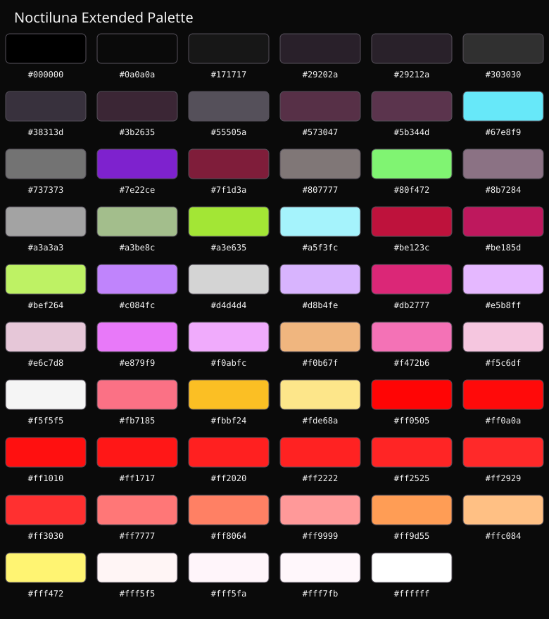

# Noctiluna

A dark colour scheme with deep charcoal backgrounds, soft neutral foregrounds, and vibrant pink, purple and cyan accents.

Designed for a consistent appearance across Linux terminals, editors and desktop applications.

## Colour palette



### Core colours

| Colour | Hex | Purpose |
|---|---|---|
| <span style="color:#0a0a0a">■</span> Nocturne | `#0a0a0a` | Background |
| Obsidian | `#171717` | Surfaces and containers |
| Moonlight | `#f5f5f5` | Foreground and text |
| Orchid | `#f472b6` | Primary accent |
| Plum | `#3b2635` | Selection background |
| White | `#ffffff` | Bright foreground |

The extended palette contains additional pink, rose, purple, cyan, green, lime, yellow, orange and neutral shades.

## Terminal themes

Noctiluna provides a consistent 16-colour ANSI palette across three terminals.

| Terminal | Theme file |
|---|---|
| Ghostty | `terminals/ghostty/noctiluna.conf` |
| LXTerminal | `terminals/lxterminal/noctiluna.conf` |
| XFCE4 Terminal | `terminals/xfce4-terminal/Noctiluna.theme` |

### Ghostty

Use the settings in `terminals/ghostty/noctiluna.conf` in your Ghostty configuration.

### LXTerminal

Merge the colour entries from `terminals/lxterminal/noctiluna.conf` into the `[general]` section of `~/.config/lxterminal/lxterminal.conf`. Preserve your existing font, shortcuts and other preferences.

LXTerminal does not expose all the cursor and selection colour controls available in some other terminals.

### XFCE4 Terminal

Copy `terminals/xfce4-terminal/Noctiluna.theme` into:

`~/.local/share/xfce4/terminal/colorschemes/`

Create the directory if necessary. Open XFCE4 Terminal Preferences, select Colors, and choose Noctiluna from the presets.

## Editors and desktop applications

| Application | Theme file |
|---|---|
| Sublime Text | `editors/sublime-text/Noctiluna.sublime-color-scheme` |
| Qt6ct | `desktop/qt6ct/noctiluna.conf` |
| Ghostwriter | `desktop/ghostwriter/Noctiluna-Ghostwriter.json` |
| Fluux Messenger | `desktop/fluux/Noctiluna.json` |
| Lightning Matrix | `desktop/lightning/Noctiluna.json` |

### Fluux Messenger

In Fluux Messenger, open Settings → Appearance → Import theme and select `desktop/fluux/Noctiluna.json`.

### Lightning Matrix

The theme is provided as `desktop/lightning/Noctiluna.json`.

## Browser themes

| Browser | Theme files |
|---|---|
| Vivaldi | `browsers/vivaldi/` |
| Firefox / LibreWolf | `browsers/firefox/` |

### Vivaldi

Import the packaged `Noctiluna-Vivaldi.zip` through Vivaldi's theme settings.

### Firefox / LibreWolf

The Firefox theme is provided as a WebExtension. It can be loaded temporarily through `about:debugging`. Permanent installation requires a signed extension.

## Project structure

```text
noctiluna-colourscheme/
├── assets/                  Palette artwork
├── browsers/                Browser themes
├── desktop/                 Desktop application themes
├── editors/                 Editor themes
├── palette/                 Master colour definitions
└── terminals/               Terminal themes
```

## Design philosophy

- Deep, near-black backgrounds
- Soft, readable foreground colours
- Pink and purple as defining accents
- Complementary cyan, green and warm highlights
- Consistent ANSI colours across supported terminals

## Licence

Released under the MIT License. See [LICENSE](LICENSE).
